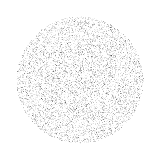
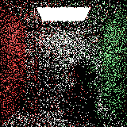
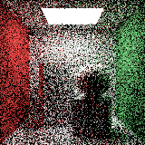
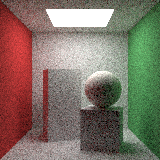
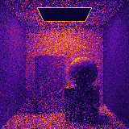
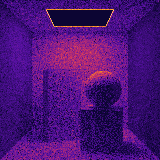
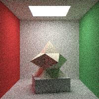

# Motor de Renderizado Path Tracer desde Cero en C++ — Ecuación Integral de Kajiya

Implementación completa desde cero en **C++17** (con concurrencia nativa `std::thread` y sin librerías gráficas de alto nivel) de un motor de **Trazado de Caminos (Monte Carlo Path Tracer)** que resuelve numéricamente la **Ecuación Integral de Renderizado de Kajiya (1986)** sobre superficies tridimensionales.

---

## 1. Fundamento Matemático

En lugar de aproximar la iluminación mediante modelos heurísticos locales (como Phong o Blinn-Phong), este motor modela físicamente el transporte de energía radiante formulando la radiancia saliente $L_o(\mathbf{x}, \omega_o)$ como una integral de superficie bidimensional definida sobre el hemisferio $\Omega$ orientado a la normal $\mathbf{n}$ de cada punto de impacto $\mathbf{x}$:

$$L_o(\mathbf{x}, \omega_o) = L_e(\mathbf{x}, \omega_o) + \int_{\Omega} f_r(\mathbf{x}, \omega_i, \omega_o) \, L_i(\mathbf{x}, \omega_i) \, (\omega_i \cdot \mathbf{n}) \, d\omega_i$$

### Cambio a Coordenadas Esféricas $(\theta, \phi)$

Parametrizando el hemisferio local mediante el ángulo cenital $\theta \in [0, \pi/2]$ y el ángulo acimutal $\phi \in [0, 2\pi)$ con diferencial de ángulo sólido $d\omega_i = \sin\theta \, d\theta \, d\phi$ y $(\omega_i \cdot \mathbf{n}) = \cos\theta$:

$$L_o(\mathbf{x}, \omega_o) = L_e(\mathbf{x}, \omega_o) + \int_{0}^{2\pi} \int_{0}^{\pi/2} f_r(\mathbf{x}, \theta, \phi, \omega_o) \, L_i(\mathbf{x}, \theta, \phi) \, \cos\theta \sin\theta \, d\theta \, d\phi$$

### Estimador Estocástico de Monte Carlo y Cancelación Algebraica

Para aproximar numéricamente esta integral multidimensional recursiva, se emplea el estimador discreto de Monte Carlo con $N$ muestras por píxel (**SPP**):

$$\langle L_o \rangle_N = L_e(\mathbf{x}, \omega_o) + \frac{1}{N} \sum_{k=1}^N \frac{f_r(\mathbf{x}, \omega_k, \omega_o) \, L_i(\mathbf{x}, \omega_k) \, (\omega_k \cdot \mathbf{n})}{p(\omega_k)}$$

Para superficies difusas Lambertianas ($f_r = \frac{\rho}{\pi}$), el motor implementa y compara dos esquemas de muestreo hemisférico mediante el método de la transformada inversa ($\xi_1, \xi_2 \sim \mathcal{U}(0,1)$):

| Esquema de Muestreo | Densidad $p(\omega)$ | Generación Esférica $(\theta, \phi)$ | Peso del Estimador $\frac{f_r \cos\theta_k}{p(\omega_k)}$ |
| :--- | :---: | :---: | :---: |
| **1. Hemisférico Uniforme** | $p(\omega) = \frac{1}{2\pi}$ | $\cos\theta = \xi_1, \; \phi = 2\pi\xi_2$ | $2 \, \rho \cos\theta_k$ |
| **2. Ponderado por Coseno (Importance Sampling)** | $p(\omega) = \frac{\cos\theta}{\pi}$ | $\cos\theta = \sqrt{1-\xi_1}, \; \phi = 2\pi\xi_2$ | $\frac{(\rho/\pi)\cancel{\cos\theta_k}}{\cancel{\cos\theta_k}/\pi} = \rho$ |

> Documentación analítica detallada disponible en [`docs/FORMULACION_MATEMATICA.md`](docs/FORMULACION_MATEMATICA.md).

---

## 2. Arquitectura del Proyecto (100% Desde Cero)

```text
├── include/
│   ├── math/
│   │   ├── vec3.hpp            # Álgebra de vectores 3D, producto punto/cruz y Base Ortonormal (ONB)
│   │   └── mat4.hpp            # Matrices homogéneas 4x4 (traslación, rotación, escalado, inversa-transpuesta)
│   ├── core/
│   │   ├── ray.hpp             # Rayo paramétrico r(t) = o + t*d
│   │   ├── material.hpp        # BRDF Lambertiana f_r = rho / pi y emisión L_e
│   │   └── camera.hpp          # Cámara estenopeica con sub-pixel jittering
│   ├── geometry/
│   │   ├── hittable.hpp        # Registro de impacto (HitRecord) y orientación de normales
│   │   ├── sphere.hpp          # Intersección analítica Rayo-Esfera (ecuación cuadrática)
│   │   ├── triangle.hpp        # Intersección analítica Rayo-Triángulo (Algoritmo de Möller–Trumbore)
│   │   ├── aabb.hpp            # Caja delimitadora (AABB) por el método de losas (Slab Method)
│   │   ├── bvh.hpp             # Árbol de aceleración espacial BVH O(log_2 M) construido desde cero
│   │   └── scene.hpp           # Escenas: Fase 1 (Furnace), Fase 2 (Cornell Box) y Cornell + Modelo OBJ
│   ├── integrator/
│   │   ├── sampling.hpp        # Generador PCG32, muestreo hemisférico uniforme y ponderado por coseno
│   │   └── path_tracer.hpp     # Integrador Monte Carlo multihilo (std::thread) + acumulador de Welford
│   ├── io/
│   │   ├── obj_loader.hpp      # Importador de mallas 3D Wavefront (.obj) desde cero con auto-normalización
│   │   └── image_export.hpp    # Exportación directa a PPM (P6) y PNG (RFC 2083 desde cero) + mapas de calor
│   ├── benchmark/
│   │   └── benchmark_suite.hpp # Suite cuantitativa de convergencia MSE, varianza y dashboard HTML
│   └── gui/
│       └── win32_viewer.hpp    # Interfaz gráfica interactiva nativa en tiempo real (Win32 GDI)
├── src/
│   └── main.cpp                # Punto de entrada CLI (--benchmark, --gui, --all)
├── tests/
│   └── test_math_and_integrals.cpp # Pruebas unitarias de álgebra, Möller–Trumbore e integrales
├── docs/
│   └── FORMULACION_MATEMATICA.md   # Deducción formal de la integral y muestreo por importancia
└── output/                     # Imágenes renderizadas (.png/.ppm), mapas de varianza y CSV/HTML
```

---

## 3. Resultados Experimentales y Validación

### Fase 1: Validación Analítica de la Integral — Horno de Luz (White Furnace Test)

Una esfera unitaria con reflectancia difusa $\rho = 1.0$ ($f_r = \frac{1}{\pi}$) encerrada en un entorno isotrópico radiante de radiancia constante $L_i = 1.0$ debe devolver exactamente:

$$L_o = \int_{0}^{2\pi} \int_{0}^{\pi/2} \frac{1}{\pi} \cos\theta \sin\theta \, d\theta \, d\phi = 1.000000$$

| SPP ($N$) | $\langle L_o \rangle$ Uniforme | Varianza Muestral Uniforme ($\text{Teórica } \frac{1}{3} \approx 0.3333$) | Error $\|\langle L_o \rangle - 1\|$ Uniforme | $\langle L_o \rangle$ Coseno | Varianza Muestral Coseno | Error $\|\langle L_o \rangle - 1\|$ Coseno |
| :---: | :---: | :---: | :---: | :---: | :---: | :---: |
| **1** | `1.002408` | `0.000000` | `0.500833` | **`1.000000`** | **`0.000000`** | **`0.000000`** |
| **4** | `1.002122` | `0.334642` | `0.234041` | **`1.000000`** | **`0.000000`** | **`0.000000`** |
| **16** | `0.999672` | `0.334385` | `0.115287` | **`1.000000`** | **`0.000000`** | **`0.000000`** |
| **64** | `0.999933` | `0.333794` | `0.058146` | **`1.000000`** | **`0.000000`** | **`0.000000`** |
| **256** | `0.999705` | `0.333392` | `0.028862` | **`1.000000`** | **`0.000000`** | **`0.000000`** |
| **1024** | `1.000049` | `0.333248` | `0.014336` | **`1.000000`** | **`0.000000`** | **`0.000000`** |

| Horno de Luz — Muestreo Uniforme ($N=4$ SPP) | Horno de Luz — Muestreo por Coseno ($N=4$ SPP) |
| :---: | :---: |
|  |  |

---

### Fase 2 y 3: Escena Estándar Cornell Box y Convergencia $\mathcal{O}(1/\sqrt{N})$

Evaluación de convergencia contra una imagen de referencia calculada con **$N = 4096$ SPP**:

| SPP ($N$) | MSE Uniforme | MSE Coseno | RMSE Coseno $\mathcal{O}(1/\sqrt{N})$ | $\text{Var}[\langle L_o \rangle]$ Uniforme | $\text{Var}[\langle L_o \rangle]$ Coseno | Factor Reducción Varianza | Tiempo (ms) |
| :---: | :---: | :---: | :---: | :---: | :---: | :---: | :---: |
| **1** | `1.310674` | `0.828331` | `0.910127` | `1.310674` | `0.828331` | **1.58x** | `4.6 ms` |
| **4** | `0.325823` | `0.205609` | `0.453442` | `0.320514` | `0.207909` | **1.54x** | `13.8 ms` |
| **16** | `0.085338` | `0.052867` | `0.229928` | `0.084319` | `0.052683` | **1.60x** | `43.5 ms` |
| **64** | `0.021515` | `0.013219` | `0.114975` | `0.021147` | `0.013021` | **1.62x** | `156.0 ms` |
| **256** | `0.005445` | `0.003490` | `0.059077` | `0.005278` | `0.003249` | **1.62x** | `606.0 ms` |
| **1024** | `0.001539` | `0.001019` | `0.031923` | `0.001319` | `0.000812` | **1.62x** | `2428.8 ms` |

> Se observa experimentalmente que al multiplicar $N$ por $4$ ($1 \to 4 \to 16 \to 64 \to 256 \to 1024$), el **RMSE se reduce exactamente a la mitad** (`0.910 -> 0.453 -> 0.229 -> 0.115 -> 0.059 -> 0.031`), verificando la tasa teórica $\mathcal{O}(1/\sqrt{N})$.

### Galería de Convergencia y Mapas de Calor de Varianza

| $N = 4$ SPP (Coseno) | $N = 16$ SPP (Coseno) | $N = 64$ SPP (Coseno) | $N = 256$ SPP (Coseno) | $N = 1024$ SPP (Coseno) | Referencia $N = 4096$ SPP |
| :---: | :---: | :---: | :---: | :---: | :---: |
|  |  |  |  |  |  |

| Mapa de Calor de Varianza — Muestreo Uniforme ($N = 64$ SPP) | Mapa de Calor de Varianza — Muestreo por Coseno ($N = 64$ SPP) |
| :---: | :---: |
|  |  |

---

## 4. Compilación y Ejecución

### Compilar el motor y ejecutar pruebas unitarias
```powershell
powershell -ExecutionPolicy Bypass -File .\build.ps1
.\build\test_math_and_integrals.exe
```

### Ejecutar el Benchmark Académico Completo (Fase 1, 2 y 3)
```powershell
.\build\kajiya_pathtracer.exe --benchmark --size 160 --ref-spp 4096
```

### Importar y Renderizar un Modelo 3D Externo (`.obj`) con Aceleración BVH
```powershell
.\build\kajiya_pathtracer.exe --obj assets/models/star_sculpture.obj --size 200
```


### Abrir el Visualizador Interactivo en Tiempo Real (Win32 GUI)
```powershell
.\build\kajiya_pathtracer.exe --gui
```
Controles dentro de la ventana interactiva:
- `[1]`: Activar **Muestreo Ponderado por Coseno** ($p(\omega) = \frac{\cos\theta}{\pi}$)
- `[2]`: Activar **Muestreo Hemisférico Uniforme** ($p(\omega) = \frac{1}{2\pi}$)
- `[V]`: Alternar entre **Radiancia Foto-realista RGB** y **Mapa de Calor de Varianza por Píxel**
- `[F]`: Alternar entre **Cornell Box**, **Horno de Luz (Furnace Test)** y **Cornell Box + Modelo `.obj`**
- `[O]`: Abrir selector de archivos de Windows para importar cualquier modelo **Wavefront `.obj`** en vivo
- `[R]`: Reiniciar acumulación de muestras
- `[S]`: Exportar instantánea actual a archivos `.png` y `.ppm`
